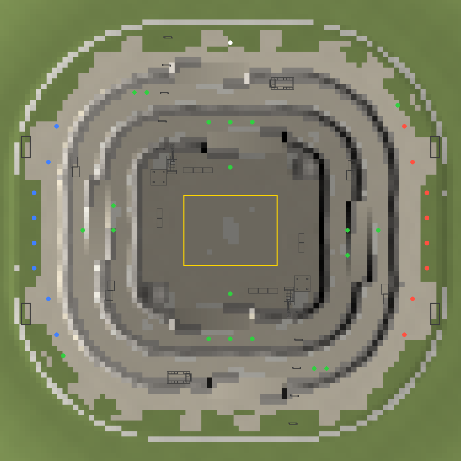

# Quarry King (q3r_quarry)

King of the Hill (`q3r_koth`) in einem Kalksteinbruch an einem Sommernachmittag
(Himmel `trainyard` wie Crossroads). Erzeugt von `tools/maptools/make_quarry.py`.



## Idee

Anders als bei Mesa King liegt der Hügel ganz unten: Die Zone ist die Sohle des
Steinbruchs. Drei Abbaustufen führen zum Rand hinauf, jede Wand ist 160 Units hoch
und mit etwa 65 Grad zu steil zum Hochfahren. Wer verteidigt, steht also tief, und
wer angreift, kommt über die Kante. Herunter geht es überall (man fällt eine Stufe
tiefer), hinauf nur über die Fahrwege. Wer in die Grube fällt, muss sich den Weg
wieder hinausfahren.

## Aufbau

- **Sohle:** abgerundetes Rechteck 2200 × 2000 Units auf Höhe −480. In der Mitte die
  Zone (`trigger_koth_hill`, 1120 × 840 und 144 hoch, der Boden darunter ganz eben),
  Krone und Leuchtpfosten zeichnet das Spiel (siehe `docs/koth_crown.md`).
- **Hügelpunkt:** Das Spiel meldet als Position des Hügels (auch an die Bots) die Mitte
  der Zone auf Höhe „Oberkante Trigger + `indicatorHeight`“. Die Map setzt
  `indicatorHeight -88`, der Punkt liegt 40 Units über der Sohle. Für die Bots ist das
  egal: Die AAS-Area der Sohle reicht bis zum Himmel, sie finden die Zone auch mit dem
  Standardwert. Die Krone ignoriert den Wert.
- **Stufen:** Stufe 1 auf −320, Stufe 2 auf −160, der Rand auf 0. Jede Stufe ist rund
  350 Units breit, die Wände sind leicht unregelmäßig, am Fuß jeder Wand liegt Schotter.
- **Fahrwege:** sechs Rampen mit knapp 10 Grad, in die Wände geschnitten. Sohle → Stufe 1
  an der Nord- und Südseite, Stufe 1 → Stufe 2 an der Ost- und Westseite, Stufe 2 →
  Rand wieder Nord und Süd. Jede Rampe gibt es zweimal, um 180 Grad gedreht.
- **Rand:** Plateau rund 550 Units breit, dahinter ein Erdwall mit unsichtbarer Wand.
  Jenseits davon Wiesen, Bäume und Hügel bis zum Horizont.
- **Spawns:** Rot auf dem Ostrand, Blau auf dem Westrand, je vier
  `team_KOTH_*player` und vier `team_KOTH_*spawn`.

Alles, was fürs Spiel zählt (Gelände, Rampen, Deckung, Pickups, Spawns), ist
punktsymmetrisch zur Mitte: um 180 Grad gedreht sieht jedes Team dasselbe.
`validate()` prüft das für das Gelände.

## Deckung und Dekoration

- Gesägte Kalksteinblöcke, gestapelt, rund 300 Units neben der Zone und auf den
  Stufen an der Außenseite.
- Zwei Schotterhaufen in den Ecken der Sohle (Sprungschanze, Sichtschutz).
- Zwei Bagger auf der Sohle an der Wand neben den Trichtern, zwei Muldenkipper auf
  Stufe 2 (Nord und Süd), gelb lackiert. Alles steht so, dass auf der Sohle und den
  Stufen mindestens 220 Units breite Fahrbahnen frei bleiben.
- Zwei Förderbänder von Trichtern auf der Sohle hinauf zu den Brecheranlagen hinter dem
  Nord- und dem Südrand (mit Silos). Die Stützen stehen im Spielfeld, das Band selbst
  hängt hoch genug, dass man darunter durchfährt.
- Bürocontainer bei den Spawns, Flutlichtmasten (`floodmast.md3`) auf den Randecken.

## Pickups (paarweise gedreht)

| Pickup | Wo |
|---|---|
| Raketenwerfer + 2 × Munition | Stufe 1 Nord / Süd |
| Schrotflinte | Sohle, Nord- und Südrand der Zone |
| Gelbe Rüstung | Stufe 2 Ost / West |
| Große Gesundheit | Stufe 1 Ost / West, Stufe 2 Nordwest / Südost |
| Treibstoff | Stufe 1 West / Ost, Stufe 2 Süd / Nord |
| Turbo | Randecken Nordost / Südwest |

## Bauen

```text
python tools/maptools/make_quarry.py
q3map2 -game quake3 -fs_basegame baseq3r -fs_basepath <repo> -meta -custinfoparms -keeplights <map>
q3map2 -game quake3 -fs_basegame baseq3r -fs_basepath <repo> -vis -fast -saveprt <map>
q3map2 -game quake3 -fs_basegame baseq3r -fs_basepath <repo> -light -custinfoparms -fast -shade -filter -super 2 -bounce 1 <map>
```

Der Generator schreibt die Map, `maps/q3r_quarry_index.pcx`, `scripts/q3r_quarry.shader`
und `.arena`, die Texturen in `textures/q3r_quarry/` sowie `quarry_layout.png` und
`validation.json` hier. Die hellen Kalksteintexturen (`dust`, `gravel`, `limestone`,
`block`) leitet er aus vorhandenen Texturen ab (`q3r_dirt_grass/dirt02`, `rock03`,
`q3r_ground/pebble01`): entsättigt, aufgehellt, weniger Kontrast. Die Wandtextur gibt
es zweimal, seitlich projiziert für Wände in x- und in y-Richtung, damit nichts
verzerrt.

`shaderlist.txt` muss `q3r_quarry` und `q3r_lanterns` (Flutlichtmasten) enthalten.

Die AAS wird aus der Ersatzkarte gebaut (`docs/maps/aas_proxy.md`), bspc braucht dafür
etwa anderthalb Minuten.

## Geprüft

- `validate()`: Zone eben, Gelände punktsymmetrisch, Rampen höchstens 9,8 Grad, Wände
  64–66 Grad, kein Spawn und kein Pickup in einem Objekt oder unter einem Förderband,
  nichts Festes in der Zone.
- AAS aus der Ersatzkarte: 8679 Areas, rund 42.000 Erreichbarkeiten.
- Bots: In einem engeren Deckungslayout blieb ein Bot zwischen Blockstapel und
  Schotterhaufen neben der Zone hängen, daher die breiten Fahrbahnen. Jetzt fahren im
  1-gegen-1 beide Bots sofort in die Grube und kreisen in der Zone (umkämpft); im
  3-gegen-3 erreichen beide Teams die Zone. Eine Eroberung durch Bots kam in den Tests
  nicht vor, weil immer beide Teams in der Zone waren.
- Im Spiel angesehen: Rand, Stufen, Rampen, Sohle mit Krone und Pfosten, Bagger,
  Muldenkipper, Förderbänder, Brecheranlagen.

Offen: Spieltest mit Menschen, vor allem ob die Verteidiger in der Grube zu leicht
oder zu schwer zu vertreiben sind; Balance der Pickups.
