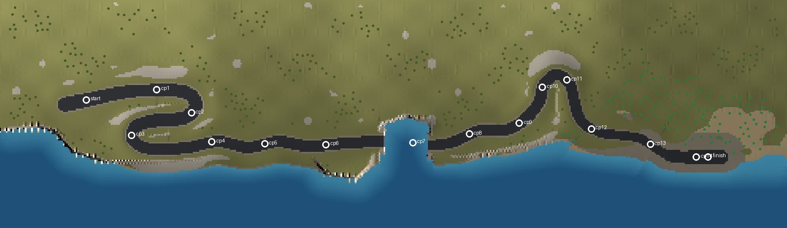

# Riviera Run (q3r_riviera)

Sprint von A nach B an einer Mittelmeerküste bei Sonnenuntergang: vom Leuchtturm auf
dem Kap hinunter bis zur Kaimauer im Fischerhafen, das Meer immer rechts. Erzeugt von
`tools/maptools/make_riviera.py`.



## Strecke

Rund 35.800 Units lang, geschätzt gut eine Minute Fahrzeit. Start auf 897, Ziel auf
34 Höhe, größte Steigung 8,7 %, engster Radius 414 Units (Mittellinie).

| Abschnitt | Was passiert |
|---|---|
| Start | Plateau am Leuchtturm, Startportal, Startaufstellung 4 × 2 |
| Kehren | zwei Haarnadelkurven die Klippe hinunter, Felseinschnitte auf der Bergseite |
| Klippenstraße | über dem Meer, Leitplanke auf der Seeseite |
| Tunnel | durch eine Landzunge, Gewölbe mit Lampen |
| Brücke | Bogenbrücke über eine Bucht, 269 Units über dem Wasser. An beiden Enden läuft die Straße ohne Stufe auf das Deck (das erste und letzte Deckstück hat keine gezeichnete Oberseite, darunter liegt die Fahrbahn), daneben reicht das Gelände steil an die Brückenwand |
| Landzunge | Anstieg durch Olivenhaine |
| Hufeisen | weite Kehre um eine Schlucht hinunter zur Altstadt |
| Altstadt | enge Gasse zwischen 19 Häusern mit Ziegeldächern und Wandlaternen; die Fassaden sind pro Haus eingepasst (ganze Fensterachsen von etwa 100 Units, ganze Stockwerke von der Traufe abwärts), so dass kein Fenster an einer Ecke oder am Dach abgeschnitten wird |
| Hafen | Kaimauer mit Pollern und Booten, Ziel, dahinter die Mole mit dem Hafenfeuer |

Start (`rally_start`) und Ziel (`rally_finish`) haben je ein Banner-Portal.
Vor den drei engen Kurven (beide Kehren, Hufeisen) stehen je drei Chevron-Schilder;
die Pfeile zeigen in die Kurvenrichtung (`chevron_r` / `chevron_l`, auf die
Fahrerseite des Schilds eingepasst wie die Banner, damit die Q3-Projektion sie nicht
spiegelt). Dazwischen liegen 14 Checkpoints
(`rally_checkpoint`), siehe Layout.

## Checkpoints und Bot-Route

Die Checkpoints setzt der Generator nicht von Hand, sondern nach der Bot-Route: Bots
fahren auf Sprintstrecken eine Bézierkurve von Checkpoint zu Checkpoint (Punkt und
Tangente aus `maps/q3r_riviera.bpd`, siehe `g_race_route.c`). Ohne `.bpd` sind das
gerade Linien, und in der ersten Kehre fuhr der Bot geradeaus in den Hang. Der
Generator geht deshalb vom Start aus die Mittellinie entlang und setzt jeden
Checkpoint so weit hinten wie möglich, solange eine einzige kubische Kurve der Straße
noch auf 64 Units genau folgt (höchstens 3.500 Units Abstand, Tangentenlänge höchstens
900). In den Kehren und am Hufeisen liegen sie deshalb dichter, auf den langen Geraden
weiter auseinander. Er schreibt dazu die `.bpd`; aus derselben Route baut das Spiel
auch die Rennintro-Kamera.

## Streckenbegrenzung

Die Landschaft ist offen, die Strecke trotzdem ein geschlossener Korridor:

- **Seeseite:** Stahlleitplanke auf Pfosten, darüber eine unsichtbare Wand bis 420 über
  der Fahrbahn. Auf der Brücke und am Kai übernehmen das die Brüstung bzw. die
  Kaimauer.
- **Bergseite:** unsichtbare Wand 110 Units hinter dem Schotterstreifen, auf halber
  Höhe im Felseinschnitt, so dass man sie kaum bemerkt. Wo zwei Streckenteile nah
  beieinander liegen (die Kehren), rückt sie in die Mitte dazwischen; in der Altstadt
  steht sie an den Hausfronten und schließt die Gassen.
- An den Enden stehen Querwände hinter Start und Ziel.

Ohne die Bergseite fuhren Bots im ersten Test in der ersten Kehre geradeaus auf den
Hang und später über die Landzunge in die Bucht. Eine Rasterprüfung (alle Wände als
Grundriss, Lücken unter 64 Units zählen als zu) bestätigt jetzt, dass man vom Start
aus nur über die Fahrbahn ins Ziel kommt.

## Landschaft

- Ein Höhenfeld wie bei Ridge Pass: Küste, Kap, Landzungen, Hügel im Hinterland, an
  die Straße angeschnitten und aufgeschüttet. Kollision über Dreiecks-Detailbrushes im
  64/128/256/512-Raster, fein nur nahe der Straße.
- Bodenschichten per Indexmap (`maps/q3r_riviera_index.pcx`): Gras, Schotter, Asphalt,
  Fels, Steilwand, Sand. Bis 700 Units um Kai und Altstadt Schotter statt Sand.
- Meer als Wasservolumen auf Höhe 0, Himmel `env/ely_sunset` mit tief stehender Sonne
  und Dunst.
- Bäume: Palmen am Wasser und in der Stadt (`models/mapobjects/palmier`) und
  Olivenbäume auf den Hügeln (`GR_trees/tree4`, `tree6`), zusammen 460, nie in einem
  Haus oder an der Kaimauer. Die Palmenmodelle sind nur 15 Units hoch und zeigen auf
  einen Shader, den es nicht gibt: Die Map skaliert sie auf das 22- bis 29,5-Fache
  (330–440 Units) und biegt per `_remap` alle Flächen auf den eigenen Shader
  `models/mapobjects/palmier/palmier1` in `q3r_riviera.shader` um (Textur-Atlas mit
  Wedeln, Stamm und Kokosnuss, Alpha-Test). Dazu Felsbrocken, Leuchtturm, Boote.

## Bauen

```text
python tools/maptools/make_riviera.py
q3map2 -game quake3 -fs_basegame baseq3r -fs_basepath <repo> -meta -custinfoparms -keeplights <map>
q3map2 -game quake3 -fs_basegame baseq3r -fs_basepath <repo> -vis -fast -saveprt <map>
q3map2 -game quake3 -fs_basegame baseq3r -fs_basepath <repo> -light -custinfoparms -fast -shade -filter -super 2 -bounce 1 <map>
```

Der Generator schreibt:
- die Map, die Indexmap `maps/q3r_riviera_index.pcx` und die Bot-Route `maps/q3r_riviera.bpd`
- `scripts/q3r_riviera.shader` und `scripts/q3r_riviera.arena`
- `textures/q3r_riviera/` (Makrotextur, Chevron, Start- und Zielbanner)
- die Intro-Kamerafahrt `intro_routes/q3r_riviera_tl1_rev0.route`
- `docs/maps/riviera/riviera_layout.png` und `validation.json`

`shaderlist.txt` muss `q3r_riviera` und `q3r_lanterns` (Wandlaternen) enthalten.

Die AAS wird wie bei Ridge Pass aus einer Ersatzkarte gebaut (`docs/maps/aas_proxy.md`):
`make_aas_proxy.py` vereinfacht das Gelände, bspc baut daraus die AAS, danach bekommt
sie mit `--checksum` die Prüfsumme der echten BSP. bspc braucht dafür gut zehn Minuten.
Ändert sich nur etwas ohne Kollision (Shader, Trigger, Modelle), reicht die
Prüfsumme allein.

## Geprüft

- **AAS:** 25.221 Areas, 126.510 Erreichbarkeiten. Das ist viel, lädt aber
  ohne Probleme; die Grenze von 65.536 in
  `be_aas_reach.c` gilt nur, wenn das Spiel die Erreichbarkeiten selbst berechnet.
- **Bots, Sprint (`g_gametype 7`), 4 Bots, drei Läufe:** Alle nutzen die BPD-Route
  (`G_RaceRoute: source=bpd`), das Rennintro läuft. Im ersten und dritten Lauf kamen alle vier ins
  Ziel, im zweiten blieb einer zwischen der ersten und zweiten Kehre hängen. Der
  schnellste Bot braucht rund 77 s, die anderen bis 98 s.
- **Im Spiel angesehen:** Start- und Zielportal, Kehren mit Leitplanke und Chevrons,
  Tunnel, Brücke, Hufeisen, Altstadt, Kai, Palmen. Die unsichtbaren Wände sieht man
  nicht.

Bekannt: Von der Bucht aus (in Fahrtrichtung nicht im Blick) sieht man die Felsmasse
über dem Tunnel als kantigen Block.

Offen: Spieltest mit Menschen (Fahrgefühl, Zeit, ob die Wand auf der Bergseite stört).
