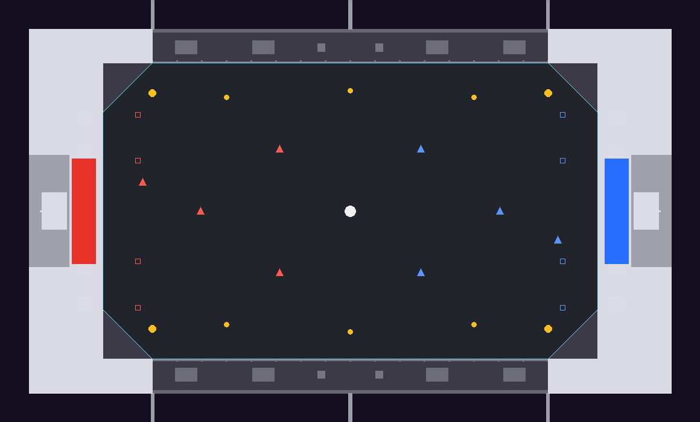

# Rooftop Arena (q3r_rooftop)

Autoball-Arena für 4 gegen 4 auf dem Dach eines Hochhauses, nachts mitten in einer
Neon-Stadt (Skybox `env/ely_darkcity`). Erzeugt von `tools/maptools/make_rooftop.py`.



## Aufbau

- **Spielfeld:** 5120 × 3072 Units (Torlinien bei x = ±2560, Glasbanden bei
  y = ±1536), so groß wie Sundown Stadium. Die Ecken sind um 512 Units abgeschrägt,
  am Fuß aller Wände liegt eine 45-Grad-Kehle (48 Units), damit der Ball nirgends
  hängen bleibt. Dunkler Gummibelag mit leuchtenden Linien, die Hälften leicht in
  Teamfarbe (Rot im Westen, Blau im Osten).
- **Längsseiten:** halbhohe Glasbanden (144 Units) mit Handlauf. Darüber liegt
  unsichtbarer Player-Clip bis z 2048: Autos bleiben auf dem Dach, der Ball nicht.
  Fliegt er über das Glas, landet er auf dem Sims oder fällt vom Haus, und es gibt
  einen neuen Anstoß. Hohe Schüsse an der Seite sind also ein Risiko.
- **Stirnseiten:** zweistöckige Aufbauten (640 hoch) mit den Toren (1088 × 320,
  320 tief, Pfosten und Netze wie in Sundown), darüber LED-Laufschrift, Neonbänder
  in Teamfarbe. Auf den Dächern: Treppenhaus mit EXIT-Licht, Antenne mit
  Warnlicht, Klimageräte und je zwei Flutlichtmasten (`floodmast.md3`), die mit
  Spotlichtern über Kreuz auf das Feld leuchten.
- **Kameraschienen:** An beiden Längsseiten hängt 600 Units vor der Dachkante eine
  Seilkamera-Schiene auf Auslegern (z 280–340) mit Kamerawagen. Sie ist solide, weil
  die TV-Kamera von Autoball (`cg_autoball.c`) seitlich von 150 über der Tormitte
  (z 310) nach einer Wand sucht und 260 davor steht. Ohne die Schiene fände sie bei
  den niedrigen Glasbanden keine Wand und stünde 5000 Units weit draußen hinter der
  Hausfassade. So filmt sie von schräg oben über der Straße.
- **Anzeigetafel:** schwebt über dem Anstoßpunkt (`rally_scoreboard`, z 760).
- **Umgebung:** Fassade des eigenen Turms mit beleuchteten Büros bis zur Straße
  4000 Units tiefer, ringsum 148 Hochhäuser (gespiegelt, damit beide Seiten
  dasselbe sehen) mit Neonkronen und roten Warnlichtern, drei Leuchtreklamen
  (Q3RALLY, AUTOBALL, NITRO), Straßenraster ganz unten. Alles davon ist nicht
  solide und zählt weder für die Kollision noch für die AAS.
- Nachts mit 35 % Regenwahrscheinlichkeit.

## Spielelemente

| Element | Wo |
|---|---|
| Ball (`autoball_ball`) | Anstoßpunkt (0, 0) |
| Anstoß (`team_CTF_*player`) | je 4, punktsymmetrisch wie in Sundown |
| Respawn (`team_CTF_*spawn`) | je 4 vor dem eigenen Tor |
| Turbo groß (5000 ms, alle 10 s) | 4, nahe den abgeschrägten Ecken |
| Turbo klein (1500 ms, alle 4 s) | 6, an den Seitenlinien und der Mittellinie |
| Tore (`autoball_goal`) | ein Ballradius hinter der Torlinie bis zum Netz |
| Rücksetzzonen (`autoball_reset`) | 14 achsparallele Quader, siehe unten |

## Rücksetzzonen

Das Spiel prüft den Ballmittelpunkt gegen den Begrenzungsquader jeder
`autoball_reset`-Entity. Deshalb ist jede Zone eine eigene Entity und achsparallel:

- neben den Glasbanden ab 30 Units hinter dem Glas, bis z 110 (Sims und alles
  darunter),
- über den Stirnaufbauten ab z 620,
- hinter dem Gebäude an den Stirnseiten bis z 620,
- über den Seitenteilen und den Eck-Abschrägungen ab z 620 (über den Ecken ist
  das auch der Luftraum des Spielfelds ab 620 Höhe).

Fällt der Ball trotzdem vom Haus, greift die eingebaute Rettung (1500 Units unter
dem Anstoßpunkt).

## Bauen

```text
python tools/maptools/make_rooftop.py
q3map2 -game quake3 -fs_basegame baseq3r -fs_basepath <repo> -meta -custinfoparms -keeplights <map>
q3map2 -game quake3 -fs_basegame baseq3r -fs_basepath <repo> -vis -saveprt <map>
q3map2 -game quake3 -fs_basegame baseq3r -fs_basepath <repo> -light -custinfoparms -fast -shade -filter -super 2 -bounce 1 <map>
bspc -forcesidesvisible -optimize -bsp2aas <bsp>
```

Der Generator schreibt die Map, `scripts/q3r_rooftop.shader` und `.arena`, die
Texturen in `textures/q3r_rooftop/` (Belag, Linienbild, Glas, Fassaden,
LED-Schrift, Leuchtreklamen, Straßen) sowie `rooftop_layout.png` und
`validation.json` hier. Nur das Gehäuse um die Skybox ist strukturell, alles andere
Detail; `_blocksize 0` hält Vis bei einem Cluster (die Stadt ist ohnehin offen).
`shaderlist.txt` muss `q3r_rooftop`, `q3r_sundown` (Tore) und `q3r_lanterns`
(Flutlichtmasten) enthalten. Die AAS baut bspc direkt in einer Sekunde.

## Geprüft

- Ball mit `ball_kick` getestet: über das Seitenglas geschossen gibt es sofort einen
  neuen Anstoß ("out of play"), flach gegen das Glas prallt er zurück und bleibt im
  Spiel, hoch auf den Stirnaufbau ebenfalls neuer Anstoß, ins Tor zählt.
- AAS: 887 Areas, alle Anstoß-, Respawn- und Turbo-Punkte erreichen beide Tore und
  die Ecken.
- 4 gegen 4 mit Bots: Die Bots fahren, spielen den Ball und schießen Tore (8 Tore in
  gut fünf Spielminuten). Die TV-Kamera filmt von der Kameraschiene.

Offen: Spieltest mit Menschen, Balance der Turbo-Pads, ob die Glashöhe (144) zu viele
oder zu wenige Bälle aus dem Spiel lässt.
